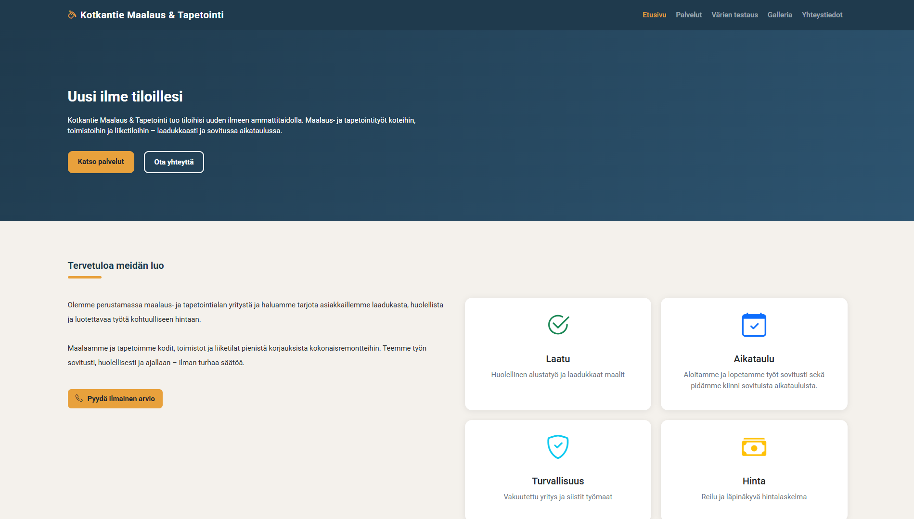

# Kotkantie Maalaus & Tapetointi

Loppytyö **Selainohjelmointi**-kurssille: yrityksen esittelysivusto kuvitteelliselle maalaus- ja tapetointiyritykselle.

🔗 **Demo:** https://gashgaieditor.github.io/Loppytyo_Selainohjelmointi

Etusivun esikatselu



## Projektin kuvaus

Kotkantie Maalaus & Tapetointi on sivusto, joka esittelee yrityksen maalaus- ja tapetointipalvelut koteihin, toimistoihin ja liiketiloihin. Sivuston avulla asiakas voi tutustua palveluihin, testata värejä, katsoa töiden esimerkkejä ja ottaa yhteyttä yritykseen.

## Sivut ja ominaisuudet

- **Etusivu** – yrityksen esittely ja pikalinkit palveluihin ja yhteydenottoon
- **Palvelut** – maalaus- ja tapetointipalvelut
- **Värien testaus** – värien kokeilu ja vertailu
- **Galleria** – kuvia tehdyistä töistä
- **Yhteystiedot** – yhteydenotto yritykseen

## Käytetyt teknologiat

- HTML5
- CSS3
- JavaScript

## Projektin rakenne

```
Nayttotyo-selainohjelmointi/
├── css/
├── js/
├── kuvat/
├── galleria.html
├── index.html
├── palvelut.html
├── varientestaus.html
├── yhteystiedot.html
└── README.md
```


## Käyttöönotto

1. Kloonaa repositorio:
```bash
   git clone https://github.com/[käyttäjänimi]/Lopputyo-Selainohjelmointi.git
```
2. Avaa kansio ja avaa `index.html` selaimessa.

Erillistä asennusta ei tarvita.

## Tekijä

Elmo Rinne – OSAO 2026
